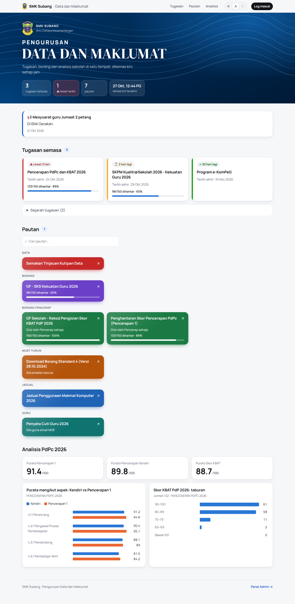
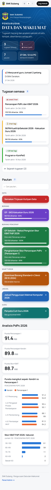
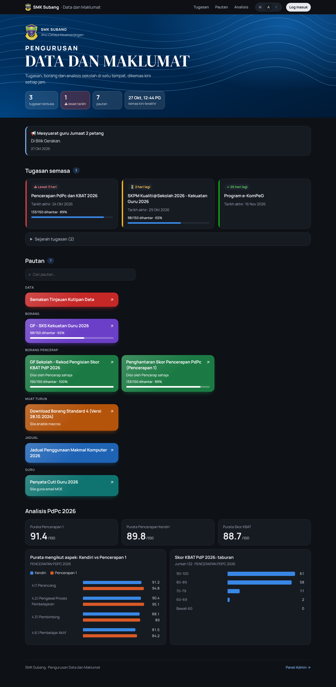
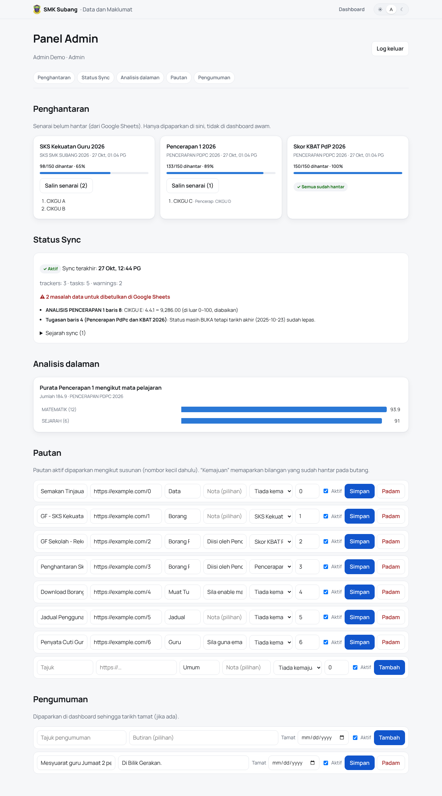

# School Data Dashboard: SMK Subang

**A real school's data dashboard: one public page and a login-protected admin panel that replaced a link
page and a messy task spreadsheet, kept fresh from Google Sheets every hour.**

> This is a public portfolio copy of a project in use at a secondary school in Malaysia (SMK Subang).
> School file IDs, project IDs, staff names and photos have been removed; the code is otherwise the same.
> UI text is in Bahasa Melayu, the language of its users.



## The problem

The school's data manager ran everything through a page of seven links and one large "SEMAKAN" spreadsheet:

- Teachers clicked through to Google Sheets to find what was due, and deadlines got missed.
- Nobody could see at a glance who hadn't submitted a form; chasing meant scrolling sheets of 150 names.
- Bad data slipped in (a score of **9,286** in a 0–100 column, tasks still "BUKA" weeks after their deadline).
- Leave statements, the lab timetable and observation scores lived in separate files, each with its own link.

## The solution

One site with a view switcher, read from the same sheets people already edit ("legacy kept": the sheets stay
the source of truth, and every view links back).

- **Public page:** open tasks with countdowns and submission progress (“133/150 dihantar”), colour-coded
  links, announcements, PdPc analysis charts, lab timetable.
- **Panel Admin (login):** who hasn't submitted, with a one-tap *copy for WhatsApp* list; data problems to fix
  with sheet + row; accounts and roles; an append-only audit log; leave summary for every teacher.
- **Passwordless onboarding:** a new admin gets a one-time set-password link (24 h, single use) sent
  straight to Telegram, the app the teachers actually use. Nobody ever types or sees someone else's password.
- **Built for phones first:** instant view switching with no page reloads, card layouts instead of sideways-scrolling
  tables, and the school crest as an installable home-screen icon.
- **Teachers' own leave statement** through a personal secret link (no login, no IC numbers).
- **Hourly sync** from Google Sheets/Forms via Apps Script, plus a *Sync sekarang* button.

| Phone | Dark mode | Admin panel |
|---|---|---|
|  |  |  |

*Screenshots use sample data (made-up names).*

## Architecture

```
            ┌──────────── one Vercel project (vercel.json services) ────────────┐
Browser ──► │ /*      → web (Next.js) ──binding API_URL──► smksubang-api        │ ──► Supabase
            │ /api/*  → smksubang-api (Express)                                 │    (Postgres + RLS + Auth)
            └───────────────────────────────────────────────▲─────────────────┘
   Google Sheets/Forms ─► Apps Script ── POST /api/sync ─────┘  (hourly)
```

| Folder | What it is |
|---|---|
| `web/` | Next.js site: public dashboard, `/admin` panel, `/cuti/<token>` personal pages |
| `api/` | Express API, one router per module |
| `supabase/` | SQL migrations (tables, RLS, audit trigger) and starter data |
| `google-apps-script/` | Runs in the school's Google account; reads the sheets and pushes aggregates to the API |

## Modules

| Module | What it does |
|---|---|
| **Tugasan** (tasks) | Open tasks from the SEMAKAN sheet with countdown, urgency and submission progress; full sheet as a filterable table |
| **Pautan** (links) | Searchable, category-coloured link buttons with live progress, edited in Panel Admin |
| **Penghantaran** (submissions) | Public sees counts only; admins see pending names and copy them for WhatsApp |
| **Analisis** (analysis) | Averages, score bands, self vs observed scores per aspect, KBAT distribution |
| **Pengumuman** (announcements) | Notices with an optional end date |
| **Jadual Makmal** | Computer-lab timetable read from an Excel file in Drive; teacher names only after login |
| **Penyata Cuti** | Leave summary for ~150 teachers, read in time-boxed batches; personal links for each teacher |
| **Status Sync** | Last sync, *Sync sekarang*, and a to-fix list of data problems |
| **Akaun** (accounts) | Add admins and principals; each gets a one-time set-password link via Telegram share (no bot) or copy |
| **Log Audit** | Every login and every admin change (old → new), append-only, enforced by a database trigger |
| **Pengesahan Input** | Adds validation to the source Forms/Sheets: 0–100 scores, required fields, dropdowns, real dates |

## Access control

| | Public | **pentadbir** (principal, read-only) | **admin** (data manager) | **system** (Apps Script) |
|---|:-:|:-:|:-:|:-:|
| Dashboard, counts, public charts | ✅ | ✅ | ✅ | – |
| Names not yet submitted, teacher names, leave summary | ❌ | ✅ | ✅ | – |
| Status Sync, internal analysis, Log Audit | ❌ | ✅ | ✅ | – |
| Edit links and announcements | ❌ | ❌ | ✅ | ✅ |
| Manage accounts and roles | ❌ | ❌ | ✅ | ❌ |
| Push data (`POST /api/sync`) | ❌ | ❌ | ✅ | ✅ |

## Privacy by design

- **The public page only ever gets totals.** Public tables hold counts; pending-name lists, leave data and
  accounts live in private tables, shown only in Panel Admin.
- **Row-level security:** public tables are read-only to everyone; private tables (`admins`, `audit_log`,
  `tracker_pending`, leave data) have **no policy**, so only the server's secret key can read them.
- **The API checks the role on every request**, and strips teacher names from lab/leave data for anonymous callers.
- **Personal leave links** are 192-bit random tokens: no IC number or birthdate (both easy to guess and
  personal data under Malaysia's PDPA). Pages are `noindex`, `no-referrer`, and analytics never record the token.
- **Set-password links** are random tokens stored only as a SHA-256 hash, valid 24 hours and usable once; a new link
  cancels the older one. The setup page is `noindex`/`no-referrer`, and the audit log records that a link was made
  or used, never the link or the password.
- **Audit log** can't be edited or deleted (database trigger), and never stores passwords.

## Data quality

- The sync flags out-of-range scores (they're left out of averages) and tasks still open after their deadline,
  with the sheet and row, so they're fixed **at the source**.
- Words such as *"belum respons"* count as pending and *CTG/CUTI* (on leave) are left out of totals instead of
  being reported as errors.
- *Pengesahan Input* stops mistakes at entry by adding validation rules to the Google Forms and Sheets themselves.

## Tech stack

Next.js (App Router) · React · Express · Supabase (Postgres, RLS, Auth) · Vercel (one project, two services,
Web Analytics) · Google Apps Script + clasp · GitHub Actions (CI, plus database migrations applied automatically on
merge) · Web App Manifest · optional email via Resend · hand-rolled SVG charts (accessible, light/dark).

## Recent updates

| Version | What changed | Why |
|---|---|---|
| **2.16** | School crest as favicon and home-screen icon (squared, maskable for Android), web manifest | Teachers add the dashboard to their phone's home screen; it should look like the school's own app |
| **2.15** | Client-side view switching with a pending indicator, one-line week picker for the lab timetable, stacked card tables and a compact header on phones | Most teachers open it on a phone; the header used to take 600 px before any task showed |
| **2.14** | One-time set-password links instead of admin-generated passwords, shared through Telegram | Passwords were being pasted into chats; now nobody but the owner ever knows one |
| CI | Database migrations run from GitHub Actions on merge; workflows moved to Node 24 actions | No more manual `supabase db push` from someone's laptop |

Every user-visible change also ships a plain-Malay "what's new" note inside the app (`web/versions.json`).

## What I learned

- Building for real, non-technical users: the teacher's Malay guide ([PANDUAN.md](PANDUAN.md)) shaped the UI as
  much as the code did.
- Keeping existing spreadsheets as the source of truth made adoption easy: nobody had to change how they work.
- Privacy has to be designed in at every layer (sync, database policies, API, page), not added at the end.
- Messy real data (free text in score columns, links that aren't links) needs tolerant parsing *and* a visible
  to-fix list.
- Meet users where they are: the teachers do official work on Telegram, not email, so sharing went there.

## Built with AI assistance

This project was built with AI assistance (**Claude Code**), working from the school data manager's real
requirements: the problem, access rules and privacy constraints were set by people, and every change was
reviewed, tested and deployed against the live school setup.

## Run it yourself

See **[docs/SETUP.md](docs/SETUP.md)** (full technical reference: setup, API, roles) and
[CONTRIBUTING.md](CONTRIBUTING.md) (run locally). Apps Script setup: [google-apps-script/README.md](google-apps-script/README.md).
